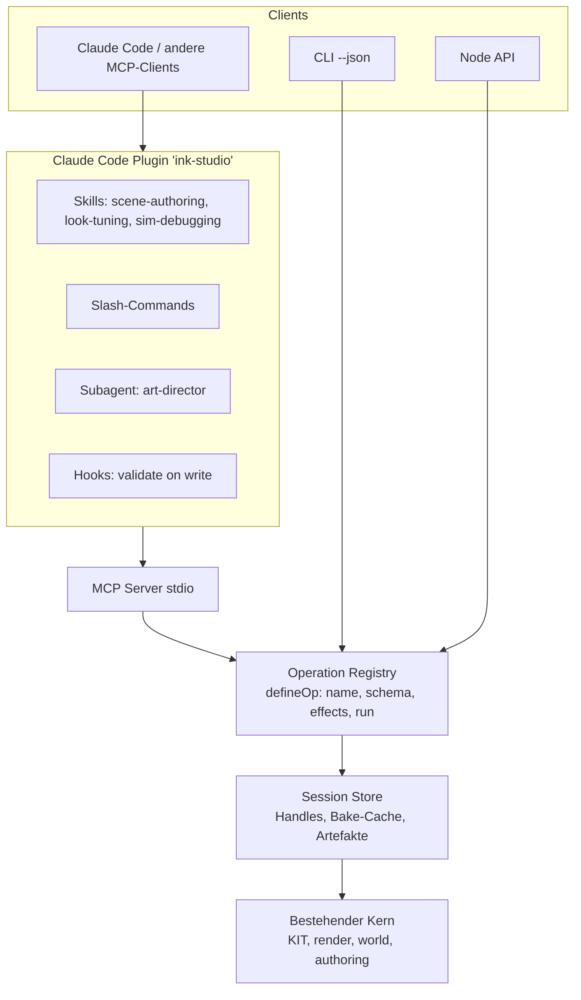

# ink-studio: Analyse und Plan für Agent-only

Stand: 20.11.2026, Basis-Commit `cac4cf8` (main). Reine Analyse, keine Code-Änderungen.

## TL;DR

- **Der Kern ist schon zu großen Teilen agententauglich, die Oberfläche nicht.** Headless CPU-Renderer, Seeds und Determinismus, JSON-Szenen, Validierung mit "did you mean", Authoring mit Revision-Hashes und Undo, Sim Record/Replay/Verify, numerische Qualitätsmetriken: alles da.
- **Das Problem ist die Schnittstelle zum Agenten:** Ausgaben sind meist Prosa oder ASCII-Balken, es gibt keine Schemas, die Discovery ist lückenhaft, die Doku umfasst etwa 1,2 MB, und jeder Aufruf ist ein Kaltstart (etwa 1,4 s). Dazu kommen 57 CLI-Commands mit handgeparsten Flags.
- **Empfehlung: kein Rewrite des Kerns.** Stattdessen eine neue Schicht **Operation Registry** (typisierte Ops mit JSON Schema). Daraus werden MCP-Server, eine JSON-first CLI und ein Claude-Code-Plugin generiert. Mensch-Oberflächen (HTML-Demos, PNG-Paint-Workflow, Prosa-Ausgaben) werden depriorisiert oder ausgelagert.
- **Nächster Schritt:** ein vertikaler Schnitt mit 5 Ops (`validate`, `open`, `render`, `measure`, `edit`) über MCP, plus eine Eval-Aufgabe, die den geschlossenen Loop "bauen, rendern, messen, editieren" beweist.
- **Stand 20.11.2026:** Phasen 1 bis 5 sind umgesetzt (Branch `agent-first/phase-2`), siehe Abschnitt 6.

---

## 1. Ist-Zustand in Zahlen

| Bereich | Umfang |
| --- | --- |
| `src/kit/` | 434 Dateien, ca. 103.000 Zeilen |
| `src/*.js` (Top-Level) | 83 Dateien, ca. 20.000 Zeilen |
| `src/webgl/` + `webgl.mjs` | ca. 8.500 Zeilen (Browser-Renderer, Shader) |
| `cli/` | 72 Dateien, ca. 17.600 Zeilen. `cli/ink-studio.js` allein hat 2.770 Zeilen |
| CLI-Commands | ca. 57 Top-Level (`CMD`-Objekt) plus Subcommands (`sim`, `scene`, `look`, `authoring`, ...) |
| Datei-Optionen (`--x file.json`) | ca. 45 (siehe `fileOptions` in `cli/shot-recipes.js`) |
| `docs/*.md` | 145 Dateien, ca. 20.000 Zeilen, ca. 1,2 MB (grob 300.000 Tokens) |
| `README.md` | 76 KB, 1.076 Zeilen |
| `examples/` | 183 JS, 89 JSON, 20 HTML (interaktive Browser-Demos) |
| `tests/` | ca. 394 Testdateien, ca. 47.000 Zeilen |
| `catalog.json` | 91 Einträge, davon nur 18 CLI und 2 API |
| Runtime-Dependencies | 0 |
| Kaltstart `stats watcher` | ca. 1,4 s, davon ca. 0,9 s Bake |

### Architektur

- **Global-Scope-Bundle:** `index.js` `files()` hängt etwa 83 handsortierte `src/*.js` und alle `src/kit/*.js` **alphabetisch** aneinander. Der Dateiname-Präfix (`k0..kz`, `p00..pcy`, `pu0..pud`, `py/pz`) ist zugleich Lade- und Abhängigkeitsreihenfolge. Jede Kit-Datei ist eine IIFE `(function (K) {...})(KIT)`.
- `load()` schreibt `dist/standalone.js` **ins Paketverzeichnis** (mtime-basierter Cache) und `require`t es.
- **Keine Typen:** kein `.d.ts`, praktisch kein JSDoc. Verträge stehen in Blockkommentaren am Dateianfang und in `docs/`.
- **Keine JSON Schemas:** Validierung ist imperativ (ca. 130 `validate(`-Stellen, `K.diorama.check`). Persistierte Formate tragen aber ein `format`-Tag (`ink-studio/world`, `/checkpoint`, `/run`, `/authoring`, `/asset-pack`, ...). Das ist eine gute Basis für Schemas.
- **CLI:** ein großes `CMD`-Objekt, handgeschriebener argv-Parser, `world.js` für `inspect/probe/trace/field/sim/scene`, `shot-recipes.js` für reproduzierbare Renders.

### Begriffskollision

"Agents" bedeutet in diesem Repo **Simulations-NPCs** (`docs/agent-decisions.md`, `agent-needs.md`, `agent-orders.md`, `agent-storage.md`, `K.world.agentDecisions`). In diesem Dokument heißen sie **Sim-Agenten**, im Gegensatz zu **KI-Agenten**. In MCP-Tool-Namen und Beschreibungen muss das sauber getrennt sein, sonst verwirrt es das Modell (z. B. `world_sim_agents` statt `agents`).

---

## 2. Agent-Readiness pro Bereich

🟢 bereit · 🟡 Substanz da, Schnittstelle fehlt · 🔴 Blocker

| Bereich | Status | Befund |
| --- | --- | --- |
| Headless Rendering | 🟢 | CPU-Renderer, `render()` in Node, Ausgabe als PNG. Native Art-Auflösung ist winzig (z. B. 225 × 155 px), Bilder sind für multimodale Modelle also **billig**. |
| Determinismus | 🟢 | Seeded PRNG, `variants --seeds`, Shot Recipes, Checkpoints, `sim verify`, `sim diff --first`. Rest-Risiko: ca. 20 `Math.random`-Stellen in `src/`. |
| Szenen als Daten | 🟡 | JSON-Dioramen funktionieren, aber ohne Schema. Der Agent muss das Format aus Prosa-Doku lernen. |
| Validierung | 🟡 | Gute Meldungen ("did you mean ball", erlaubte Keys gelistet), aber als **Text auf stderr**, nicht als strukturierte Daten. |
| Retained Authoring | 🟢/🟡 | `K.authoring.document` und `sceneEditor` sind transaktional (begin/preview/commit/undo, Revision-Hash, Optimistic Concurrency). Über die CLI ist nur `authoring inspect/preview/apply` mit 3 Op-Typen erreichbar; der volle SceneEditor (Transform, Shape, Modifiers, Material, Brush) nur über die JS-API. |
| World/Sim-Abfragen | 🟢 | `inspect/probe/trace/field` liefern JSON, `sim run/fork/replay/diff/scrub` sind deterministisch. |
| Qualitätsmetriken | 🟡 | `lint`, `crisp`, `values`, `shimmer`, `motion`, `perf`, `ramps`, `variants` liefern Zahlen. Ideal als Reward-Signal, aber meist als Text-Tabelle ausgegeben. |
| Ausgabeformat | 🔴 | Ca. 125 `console.log`/stdout-Stellen in `cli/`. JSON nur bei einem Teil der Commands (`--out report.json`, `--json` bei `perf` und `world`). `stats` gibt ASCII-Balken aus, `check` Prosa. |
| Fehler und Exit-Codes | 🟡 | `die()` gibt Text aus und beendet mit 1, einige Commands nutzen 2 für "Checks fehlgeschlagen". Es gibt keine Fehler-Codes und keine Pfade als Daten. |
| Discovery | 🔴 | `help` ist ein 150-Zeilen-Prosablock. `catalog.json` ist veraltet (18 von ca. 57 CLI-Commands). Es gibt keinen Weg zu fragen, welche Optionen ein Command hat und welche Typen sie haben. |
| Doku | 🔴 | 1,2 MB Prosa, für Menschen geschrieben, ohne Frontmatter oder Chunking. Passt nicht in einen Kontext und ist nicht gezielt abrufbar. |
| Token-Effizienz | 🔴 | Beispiel `authoring inspect`: pretty-printed JSON mit Floats wie `1.2999999999999998` und vollständigen Punktlisten. Es gibt keine `summary`/`detail`-Stufen und keine Paginierung. |
| Prozessmodell | 🔴 | Jeder Aufruf lädt das Bundle neu und bakt die Szene neu (ca. 1,4 s). Es gibt keine Session und keine Handles, und gebackene Welten werden nicht wiederverwendet. |
| Sicherheit | 🟡 | JS-Szenen sind beliebiger Code (`module.exports = kit => ...`). `ink-studio.config.js` wird aus dem CWD `require`t. Für lokale Nutzung okay, für autonome Agenten ein Risiko. |
| Installierbarkeit | 🟡 | `load()` braucht ein beschreibbares Paketverzeichnis, das scheitert z. B. in einem schreibgeschützten Plugin-Cache. |

---

## 3. Was heute für Menschen gebaut ist

| Komponente | Zweck heute | Empfehlung Agent-only |
| --- | --- | --- |
| `examples/*.html` (20) | Interaktive Browser-Demos | **Auslagern** (eigenes Repo oder `legacy/`). Die dazugehörigen JSON- und JS-Beispiele als Fixtures behalten. |
| WebGL-Renderer (`src/webgl`, ca. 8.500 Zeilen) | Live-Canvas für Browser-Hosts | **Entscheidung nötig**, siehe Abschnitt 7. Ohne Browser-Host ist er nur noch für Parity-Tests nötig. |
| `look parity`, `environment-parity` | CPU-gegen-WebGL-Vergleich, braucht Chrome | Optional halten, nicht im Agent-Pfad. |
| `paint export/absorb` | Mensch malt `paint.png` im Bildeditor, Magenta radiert | **Ersetzen** durch strukturierte Op `paint_apply({ decals: [...] })` (Weltposition, Normale, Palettenindex). Die Datenstruktur existiert bereits (`decals.json`). |
| Prosa- und ASCII-Ausgaben (`stats`, `check`, `validate`, `help`) | Lesbar im Terminal | JSON als Standard, `--human` als Opt-in. |
| `review`, `turn`, `sheet` (Contact Sheets) | Visuelle Kontrolle | **Behalten**, als Bild-Content im MCP. Für multimodale Agenten sehr wertvoll. |
| Text-Rendering (`--text ascii|braille|blocks`) | Gimmick | **Behalten**: ein Fallback für nicht-multimodale Modelle, sehr tokenarm. |
| README 76 KB | Einstieg für Menschen | Auf ca. 2 KB kürzen. Daneben `AGENTS.md` und Skill-Dateien (siehe unten). |
| `docs/*.md` (145) | Feature-Guides | Behalten, aber mit Frontmatter (`summary`, `tags`, `ops`) versehen und als MCP-Ressourcen mit Index ausliefern. |
| Interaktive Konzepte (`viewer-input`, Kamera-Controls, `pick(ray)`) | Maus und Tastatur | `pick` bleibt als Op mit expliziten Strahlen. Viewer-Input entfällt im Agent-Pfad. |

---

## 4. Designprinzipien für Agent-only

1. **Ein Vertrag pro Operation:** Name, Input-JSON-Schema, Output-JSON-Schema, Fehlercodes, Seiteneffekt-Klasse (`read`, `write`, `expensive`), Kostenhinweis.
2. **Strukturiert zuerst:** Jede Antwort ist JSON. Bilder sind Content-Blöcke oder Artefakt-Referenzen. Prosa gibt es nur als kurzes `summary`-Feld.
3. **Fehler als Daten:** `{ code, path, message, suggestion, allowed[] }`. Alle Fehler auf einmal melden, nicht nur den ersten.
4. **Zustand im Server:** Handles für Szene, Welt und Sim. Gebackene Welten werden per `(specHash, seed, options)` gecacht. Das spart den Kaltstart von ca. 1,4 s pro Schritt.
5. **Optimistic Concurrency überall:** `baseRevision` bei jeder Mutation (existiert schon im Authoring) plus `dryRun` bei jeder Mutation (existiert teilweise: `authoring preview`, `scene apply --dry-run`).
6. **Progressive Disclosure:** wenige, gut beschriebene Tools. Details holt der Agent bei Bedarf (`describe`, `schema`, `docs_get`).
7. **Token-Budget:** Floats runden (Standard 3 Nachkommastellen), Detailstufen `summary|standard|full`, Paginierung, `fields`-Auswahl.
8. **Geschlossener Loop:** Jede Mutation kann direkt `render` und `measure` anhängen (`then: ["render", "lint"]`), damit der Agent in einem Roundtrip Feedback bekommt.
9. **Daten vor Code:** JSON-Dioramen sind der Standardweg. JS-Szenen nur als vertrauenswürdige lokale Erweiterung, optional in einer Sandbox (Worker ohne `fs`).

---

## 5. Zielarchitektur



### 5.1 Operation Registry (das Herzstück)

Ein neues Verzeichnis (z. B. `ops/`) mit reinen Funktionen ohne `argv`, `console` oder `process.exit`:

```js
defineOp({
  name: 'scene.render',
  effects: 'read',
  input: { /* JSON Schema */ },
  output: { /* JSON Schema */ },
  run: async ({ handle, t, view, size }, ctx) => ({ image, artPixels, warnings })
});
```

- Die bestehenden `CMD`-Handler werden schrittweise hierher extrahiert; die CLI wird ein dünner Adapter.
- `catalog.json` wird **aus der Registry generiert**, statt von Hand gepflegt. Ein CI-Check verhindert Drift.
- Die Schemas für Dioramen entstehen aus `K.diorama.check` (erlaubte Keys und Solid-Kinds sind dort bereits aufgezählt) und den `format`-Tags.

### 5.2 MCP-Server

Statt 57 Tools etwa 15 bis 18 gebündelte Tools, um Kontext zu sparen. Verwandte Aktionen laufen über ein `action`-Enum.

| Tool | Aktionen / Zweck | Basis heute |
| --- | --- | --- |
| `ink_discover` | Katalog durchsuchen, Op beschreiben, Schema holen | `catalog`, `help` |
| `ink_docs` | Doku-Abschnitt per Thema oder Suche holen | `docs/*.md` |
| `scene_validate` | Spec prüfen und alle Probleme strukturiert zurückgeben | `K.diorama.check` |
| `scene_open` | Spec, Pfad oder Built-in öffnen, gibt Handle, Revision und Summary zurück | `dataScene`, `sceneEditor.create` |
| `scene_inspect` | Baum, Teile, Materialien, Bounds | `authoring inspect`, `sceneEditor.tree()` |
| `scene_edit` | Batch von Ops (transform, shape, modifier, material, role, suppress, ...), `baseRevision`, `dryRun`, optional `then` | `sceneEditor`, `authoring apply` |
| `scene_render` | Einzelbild, Sheet, Turn, Review, Passes; Standard `px1` (native Art-Pixel) | `render`, `sheet`, `turn`, `review`, `passes` |
| `scene_measure` | `stats`, `lint`, `crisp`, `values`, `shimmer`, `motion`, `perf`, `ramps` als Zahlen | `cli/critic.js`, `crisp.js`, `stats` |
| `scene_compare` | Gegen Referenzbild oder Look-Varianten | `compare` |
| `scene_variants` | Seeds rendern und ranken | `variants` |
| `scene_export` | GLB, Atlas, JSON, Clip | `export-glb`, `atlas`, `clip` |
| `asset_import` | Mesh, GLB, Depth-Map | `mesh`, `depth`, `readAsset` |
| `look` | inspect, sample, bake, import, export | `look *`, `lut` |
| `world_query` | inspect, probe, trace, field | `cli/world.js` |
| `world_sim` | run, resume, fork, verify, diff, scrub, take | `sim *` |
| `anim_review` | motion-review, clip-sequence, pose-review, retarget | Review-Commands |

**Ressourcen:** `ink://docs/{topic}`, `ink://catalog`, `ink://schema/{format}`, `ink://examples/{id}`, `ink://artifacts/{id}.png`.
**Prompts:** `sculpt-from-brief`, `tune-look`, `debug-sim-divergence`.
**Lange Jobs** (Sims, Bakes) laufen mit Progress-Notifications.

> Abhängigkeit: Das Repo hat heute **null** Runtime-Dependencies. Für MCP empfehle ich trotzdem das offizielle SDK, aber in einem separaten Paket (z. B. `packages/mcp` oder `@shapeshift-labs/ink-studio-mcp`). So bleibt der Kern dependency-frei.

### 5.3 Claude-Code-Plugin (lokal)

```
ink-studio-plugin/
├── .claude-plugin/plugin.json
├── .mcp.json                 # startet den MCP-Server
├── skills/
│   ├── scene-authoring/SKILL.md   # Diorama-Format, Solids, Materialien, typische Fehler
│   ├── look-tuning/SKILL.md       # Loop: render -> lint/crisp/values -> edit
│   └── sim-debugging/SKILL.md     # record, verify, diff --first, trace cause
├── commands/                 # /ink:new-scene, /ink:review, /ink:variants
├── agents/art-director.md    # Subagent: bewertet Renders gegen ein Briefing
└── hooks/                    # PostToolUse: *.scene.json validieren
```

- Für die eigene lokale Entwicklung reicht ein lokaler Marketplace-Eintrag; ein Publish ist nicht nötig.
- Skills sind der Ersatz für README und Doku im Agent-Kontext: kurz, aufgabenorientiert, mit Verweisen auf `ink_docs`.
- Plugin-Evals (`claude plugin eval`) eignen sich, um Skills und Tools messbar zu verbessern (siehe Phase 4).

---

## 6. Roadmap

| Phase | Inhalt | Ergebnis | Aufwand (grob) |
| --- | --- | --- | --- |
| **0. Entscheidungen** | Offene Fragen aus Abschnitt 7 klären, Baseline messen (Latenz, Tokens pro Aufgabe) | Klarer Scope | 0,5 bis 1 Tag |
| **1. Vertikaler Schnitt** | Registry plus 5 Ops (`validate`, `open`, `render`, `measure`, `edit`), Session-Cache, strukturierte Fehler, MCP-Server mit genau diesen Tools | Ein Agent kann eine Szene bauen und iterieren, ohne die CLI anzufassen | 3 bis 5 Tage |
| **2. Breite** | Restliche Ops migrieren (Sim, World, Look, Export, Review). CLI auf Registry umstellen, `--json` als Standard. Katalog generieren | Volle Abdeckung | 1 bis 2 Wochen |
| **3. Plugin** | Skills, Commands, Subagent, Hooks, Doku als Ressourcen mit Frontmatter | Installierbar in Claude Code | 2 bis 3 Tage |
| **4. Evals** | 10 bis 20 Aufgaben (z. B. "Laterne bauen, `lint.orphans` < 1 %", "kaputte Szene reparieren", "Sim-Divergenz finden"). Messen: Erfolgsrate, Tool-Calls, Tokens, Zeit | Objektiver Maßstab für alle weiteren Änderungen | 2 bis 3 Tage, danach laufend |
| **5. Aufräumen** | HTML-Demos und gegebenenfalls WebGL auslagern, README kürzen, `Math.random` entfernen, `load()` in ein Cache-Verzeichnis statt ins Paket | Schlankes Agent-Tool | 2 bis 4 Tage |

### Status Phase 1 (Branch `agent-first/phase-1`)

Umgesetzt in `agent/`, Nutzung siehe [AGENTS.md](AGENTS.md):

| Baustein | Datei | Stand |
| --- | --- | --- |
| Operation Registry, JSON-Schema-Subset, `OpError` | `agent/registry.js` | fertig |
| Rundung, Revision-Hash, Diff, RFC 6902 Patch | `agent/data.js` | fertig |
| Sessions mit Handles, Bake-Cache pro Revision und Seed | `agent/scenes.js` | fertig |
| Ops `scene_validate`, `scene_open`, `scene_render`, `scene_measure`, `scene_edit`, `scene_save` | `agent/ops.js` | fertig |
| MCP-Server (stdio, ohne Dependencies) | `agent/mcp-server.js`, `.mcp.json` | fertig |
| CLI-Adapter `ink-studio agent list|call|mcp` | `agent/cli.js` | fertig |
| Tests (Ops, CLI, MCP-Handshake) | `tests/agent-ops.test.js` | 8 Tests grün |

Abweichungen vom Plan:
- **6 statt 5 Tools:** `scene_save` kam dazu, sonst geht die Arbeit eines Agenten am Sitzungsende verloren.
- **MCP ohne SDK:** Der Server spricht den kleinen Teil des Protokolls selbst (initialize, ping, tools/list, tools/call), damit das Repo dependency-frei bleibt. Wenn später Ressourcen, Prompts oder Progress dazukommen, lohnt der Wechsel auf das offizielle SDK.
- **JS-Szenen standardmäßig gesperrt**, freischalten mit `--allow-code` (Entscheidung 2 aus Abschnitt 7 als Default vorweggenommen).

Gemessen: `examples/scene.json` öffnen 15 ms, Render aus dem Cache 20 bis 30 ms; `watcher` einmalig 0,9 s Bake, danach etwa 180 ms pro Render statt 1,4 s Kaltstart pro CLI-Aufruf. Die Tool-Liste kostet etwa 13 KB Kontext.

Bewusst offen für Phase 2: Brush-Ops, Prefab-Instanzen, `--params`, Paint-Korrekturen, Look-Overrides und die übrigen CLI-Commands; außerdem eine Eval-Aufgabe, die den Loop mit einem echten Agenten misst.

### Status Phase 2 bis 5 (Branch `agent-first/phase-2`, abgeschlossen)

| Phase | Ergebnis | Commit |
| --- | --- | --- |
| 2. Breite | 17 Tools: Discovery (`ink_discover`, `ink_docs`), Szene (`scene_validate/open/render/measure/edit/save/query/export`), Welt (`world_open/step/query/sim`), Long Tail (`scene_review`, `look`, `ink_cli` für jedes CLI-Command). Katalog aus Registry und Hilfe generiert (91 auf 153 Einträge), `--json` für `stats`, `lint`, `crisp`, `values` | `1f1d683`, `2baa708`, `d8af761` |
| 3. Plugin | Repo ist Plugin und lokaler Marketplace: MCP-Server, 5 Skills (3 Wissen, 2 Slash-Commands), Subagent `ink-art-director` (nur Lese-Tools), Hook zur Validierung beim Schreiben | `088e597` |
| 4. Evals | 6 End-to-End-Fälle mit `claude plugin eval`; letzter Stand 6 von 6 bestanden, etwa 2 USD pro Gesamtlauf. Shell-Transport `ink-agent`, dateibasierte Varianten von `scene_edit` und `world_step`, Reparaturmodus für ungültige Dateien | `3e0fb66` |
| 5. Aufräumen | README kurz und agent-first, voller Leitfaden in `docs/reference.md`; geseedeter Zufall in `kg-play.js`; Bundle-Fallback in einen nutzereigenen Cache | `d5ef004` |

Jede Phase lief mit Selbstreview (code-review, Stufe high), Fixes, Commit und Push. Die Reviews fanden 26 Punkte, davon 24 behoben, 1 bewusst offen (Hook lädt pro Schreibvorgang das Toolkit), 1 kein Fehler. Volle Suite am Ende: 2.055 bestanden, 0 Fehler, 60 übersprungen (wie vor den Änderungen).

**Was die Evals gefunden haben** (und was danach behoben wurde):
- Ungültige Dioramen ließen sich mit den Tools nicht reparieren, weil Öffnen eine gültige Szene verlangte. Jetzt repariert `scene_edit` per Pfad mit `patch`-Operationen.
- `ink-agent --help` war ein Fehler statt einer Hilfe.

**Wichtige Randbedingung auf diesem Rechner:** Die verwalteten Einstellungen der Organisation setzen `allowManagedMcpServersOnly: true`. Lokale MCP-Server, auch der des Plugins, starten dadurch nicht. Freischalten kann nur ein Admin, mit einem `allowedMcpServers`-Eintrag `{ "serverName": "ink-studio" }`. Bis dahin nutzen Agenten denselben Funktionsumfang über `ink-agent` in der Shell; die Skills beschreiben beide Wege. Die Evals laufen deshalb über die Shell. Der MCP-Weg ist durch automatisierte Tests abgedeckt (Handshake, Tool-Liste, Bild-Content).

**Bewusst nicht umgesetzt** (braucht deine Entscheidung, siehe Abschnitt 7):
- HTML-Demos und WebGL-Renderer bleiben im Repo. Verschieben würde relative Imports der Demos brechen, und ob Browser-Hosts noch gebraucht werden, ist offen.
- Die menschliche CLI läuft nicht vollständig über die Registry. Agenten erreichen jedes Command über `ink_cli`; ein Umbau aller 57 Commands lohnt erst, wenn die CLI für Menschen wegfallen soll.
- Kein Merge nach `main`.

### Quick Wins (unabhängig von der Roadmap)

1. **Globales `--json`** im CLI-Parser plus ein `report()`-Helfer: sofort maschinenlesbare Ausgabe für `stats`, `validate`, `lint`, `crisp`, `check`.
2. **`validate` strukturiert:** `K.diorama.check` liefert bereits Objekte mit `level`. Diese einfach als JSON ausgeben.
3. **Float-Rundung** in JSON-Ausgaben (z. B. 4 signifikante Stellen): halbiert Tokens bei `inspect` grob.
4. **`AGENTS.md`** im Repo-Root: 1 Seite mit Einstieg, Kernbefehlen und Diorama-Minimalbeispiel.
5. **`catalog.json` reparieren**, sodass alle Commands enthalten sind.

---

## 7. Offene Entscheidungen für dich

1. **Gibt es noch Browser-Hosts (Inkwell)?** Wenn nein, kann der WebGL-Renderer (ca. 8.500 Zeilen) raus aus dem Hauptpfad. Wenn ja, bleibt er, aber außerhalb des Agent-Fokus.
2. **JS-Szenen erlauben?** Empfehlung: JSON als Standard, JS nur mit Opt-in (`allowCode: true`), weil JS-Szenen beliebigen Code ausführen.
3. **Paketstruktur:** ein Monorepo mit `packages/core`, `packages/mcp`, `packages/plugin`, oder MCP und Plugin als eigenes Repo? Empfehlung: Monorepo, damit Schemas und Ops versioniert zusammenbleiben.
4. **Welche Agent-Aufgaben sind das Ziel?** Assets für ein Spiel generieren? Szenen-Previews? Sim-Experimente? Das bestimmt die Reihenfolge in Phase 2 und die Eval-Suite.
5. **Bildrückgabe:** inline (Base64-Content-Block, bei Art-Auflösung wenige KB) oder als Datei-Referenz? Empfehlung: inline bis ca. 256 × 256 Art-Pixel, darüber eine Referenz.

---

## Anhang: Kit-Domänen (Überblick)

| Domäne | Dateien (Präfixe) | Wichtige Namespaces |
| --- | --- | --- |
| Mathe und Daten | `k0-*`, `p00`, `p02`, `p04` | `K.V`, `K.M`, `K.Q`, `K.seed`, `K.procedural.data`, `K.timeDomains` |
| Geometrie und Sculpt | `k3`, `kb`, `kt`, `kv`, `kx`, `kl`, `kp`, `p29`, `p59`, `p74..p76` | `K.sculpt`, `K.sdf`, `K.form`, `K.mesh`, `K.sweep`, `K.model` |
| Szene und Stage | `k1`, `kc`, `ka`, `p24` | `K.diorama`, `K.build`, `K.sceneGraph` |
| Look, Material, Pixel | `k4`, `k5`, `km`, `kpx`, `kr`, `p69..p72`, `p90..p94`, viele `src/*.js` | `K.look`, `K.pixel`, `K.palette`, `K.paint`, `PixelLook`, `ColorStack`, ... |
| Animation und Charakter | `k2`, `kh`, `ki`, `kj`, `kk`, `kf`, `ku`, `ph*` | `K.clip`, `K.puppet`, `K.character`, `K.anim.*`, `K.timeline`, `K.cameraRig` |
| Physik und Sim | `k6`, `k7`, `k9`, `kd`, `ks`, `kw`, `kz` | `K.particles`, `K.mpm`, `K.xpbd`, `K.cloth`, `K.destruction`, `K.weather` |
| Prozedural | `p01..pcy` | `K.procedural.*` (ca. 75 Sub-Namespaces) |
| World-Runtime | `pu0..pud` (ca. 120 Dateien) | `K.world.*` inkl. Sim-Agenten, Navigation, Logistik |
| Authoring | `p23`, `p24`, `p25`, `p26`, `p77`, `p88` | `K.authoring.document`, `.sceneEditor`, `.scenePrefabs`, `.assetPacks` |
| IO | `kb`, `p91`, `p28`, `pz`, `cli/export-glb.js`, `cli/png.js` | `K.mesh`, `K.depth`, `K.dataInputs`, `exportGlb` |
| Inspektion | `kzz`, `kza`, `p84`, `pu8` | `K.inspection`, `K.ascii`, `K.comparison`, `K.fieldViews` |
