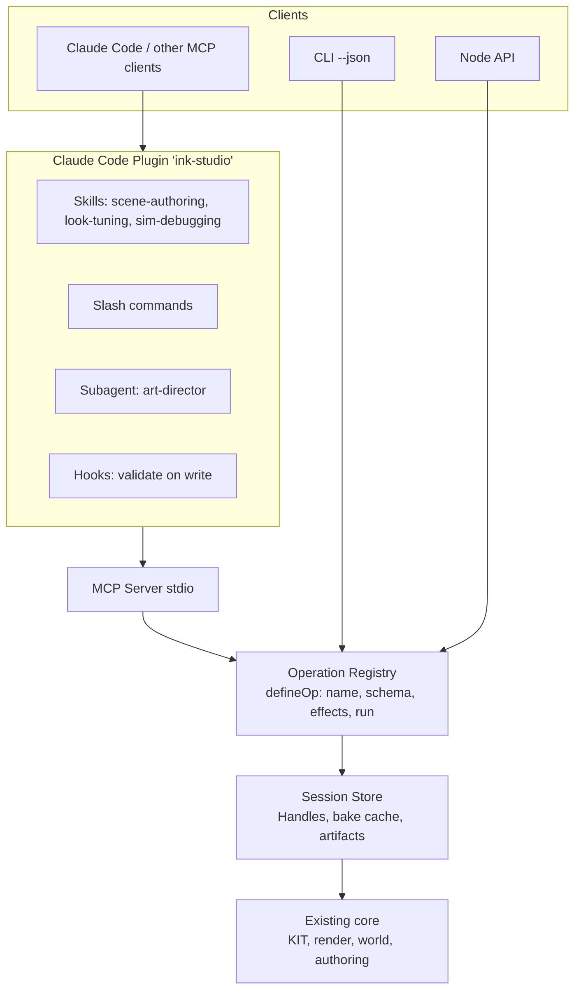

# ink-studio: Analysis and plan for agent-only

As of 20 November 2026, base commit `cac4cf8` (main). Pure analysis, no code changes.

## TL;DR

- **The core is already largely agent-ready, the surface is not.** Headless CPU renderer, seeds and determinism, JSON scenes, validation with "did you mean", authoring with revision hashes and undo, sim record/replay/verify, numeric quality metrics: all there.
- **The problem is the interface to the agent:** output is mostly prose or ASCII bars, there are no schemas, discovery has gaps, the docs total about 1.2 MB, and every call is a cold start (about 1.4 s). On top of that come 57 CLI commands with hand-parsed flags.
- **Recommendation: no rewrite of the core.** Instead, add a new layer, an **Operation Registry** (typed ops with JSON Schema). From it, generate an MCP server, a JSON-first CLI and a Claude Code plugin. Human-facing surfaces (HTML demos, PNG paint workflow, prose output) are deprioritized or moved out.
- **Next step:** a vertical slice with 5 ops (`validate`, `open`, `render`, `measure`, `edit`) over MCP, plus one eval task that proves the closed loop "build, render, measure, edit".
- **Status 20 November 2026:** phases 1 to 5 are implemented (branch `agent-first/phase-2`), see section 6.

---

## 1. Current state in numbers

| Area | Size |
| --- | --- |
| `src/kit/` | 434 files, about 103,000 lines |
| `src/*.js` (top level) | 83 files, about 20,000 lines |
| `src/webgl/` + `webgl.mjs` | about 8,500 lines (browser renderer, shaders) |
| `cli/` | 72 files, about 17,600 lines. `cli/ink-studio.js` alone has 2,770 lines |
| CLI commands | about 57 top level (`CMD` object) plus subcommands (`sim`, `scene`, `look`, `authoring`, ...) |
| File options (`--x file.json`) | about 45 (see `fileOptions` in `cli/shot-recipes.js`) |
| `docs/*.md` | 145 files, about 20,000 lines, about 1.2 MB (roughly 300,000 tokens) |
| `README.md` | 76 KB, 1,076 lines |
| `examples/` | 183 JS, 89 JSON, 20 HTML (interactive browser demos) |
| `tests/` | about 394 test files, about 47,000 lines |
| `catalog.json` | 91 entries, of which only 18 CLI and 2 API |
| Runtime dependencies | 0 |
| Cold start `stats watcher` | about 1.4 s, of which about 0.9 s bake |

### Architecture

- **Global-scope bundle:** `index.js` `files()` concatenates about 83 hand-sorted `src/*.js` files and all `src/kit/*.js` files **alphabetically**. The file name prefix (`k0..kz`, `p00..pcy`, `pu0..pud`, `py/pz`) is at the same time the load order and the dependency order. Every kit file is an IIFE `(function (K) {...})(KIT)`.
- `load()` writes `dist/standalone.js` **into the package directory** (mtime-based cache) and `require`s it.
- **No types:** no `.d.ts`, practically no JSDoc. Contracts live in block comments at the top of files and in `docs/`.
- **No JSON Schemas:** validation is imperative (about 130 `validate(` call sites, `K.diorama.check`). Persisted formats do carry a `format` tag though (`ink-studio/world`, `/checkpoint`, `/run`, `/authoring`, `/asset-pack`, ...). That is a good basis for schemas.
- **CLI:** one large `CMD` object, a hand-written argv parser, `world.js` for `inspect/probe/trace/field/sim/scene`, `shot-recipes.js` for reproducible renders.

### Term collision

"Agents" in this repo means **simulation NPCs** (`docs/agent-decisions.md`, `agent-needs.md`, `agent-orders.md`, `agent-storage.md`, `K.world.agentDecisions`). In this document they are called **sim agents**, as opposed to **AI agents**. In MCP tool names and descriptions the two must be kept cleanly apart, otherwise the model gets confused (e.g. `world_sim_agents` instead of `agents`).

---

## 2. Agent readiness per area

🟢 ready · 🟡 substance is there, interface is missing · 🔴 blocker

| Area | Status | Finding |
| --- | --- | --- |
| Headless rendering | 🟢 | CPU renderer, `render()` in Node, output as PNG. Native art resolution is tiny (e.g. 225 × 155 px), so images are **cheap** for multimodal models. |
| Determinism | 🟢 | Seeded PRNG, `variants --seeds`, shot recipes, checkpoints, `sim verify`, `sim diff --first`. Remaining risk: about 20 `Math.random` call sites in `src/`. |
| Scenes as data | 🟡 | JSON dioramas work, but without a schema. The agent has to learn the format from prose docs. |
| Validation | 🟡 | Good messages ("did you mean ball", allowed keys listed), but as **text on stderr**, not as structured data. |
| Retained authoring | 🟢/🟡 | `K.authoring.document` and `sceneEditor` are transactional (begin/preview/commit/undo, revision hash, optimistic concurrency). Through the CLI only `authoring inspect/preview/apply` with 3 op types is reachable; the full SceneEditor (transform, shape, modifiers, material, brush) only through the JS API. |
| World/sim queries | 🟢 | `inspect/probe/trace/field` return JSON, `sim run/fork/replay/diff/scrub` are deterministic. |
| Quality metrics | 🟡 | `lint`, `crisp`, `values`, `shimmer`, `motion`, `perf`, `ramps`, `variants` produce numbers. Ideal as a reward signal, but mostly printed as text tables. |
| Output format | 🔴 | About 125 `console.log`/stdout call sites in `cli/`. JSON only for some of the commands (`--out report.json`, `--json` on `perf` and `world`). `stats` prints ASCII bars, `check` prints prose. |
| Errors and exit codes | 🟡 | `die()` prints text and exits with 1, some commands use 2 for "checks failed". There are no error codes and no paths as data. |
| Discovery | 🔴 | `help` is a 150-line prose block. `catalog.json` is outdated (18 of about 57 CLI commands). There is no way to ask which options a command has and what types they are. |
| Docs | 🔴 | 1.2 MB of prose written for humans, without frontmatter or chunking. Does not fit into one context and cannot be fetched selectively. |
| Token efficiency | 🔴 | Example `authoring inspect`: pretty-printed JSON with floats like `1.2999999999999998` and full point lists. There are no `summary`/`detail` levels and no pagination. |
| Process model | 🔴 | Every call reloads the bundle and re-bakes the scene (about 1.4 s). There is no session and there are no handles, and baked worlds are not reused. |
| Security | 🟡 | JS scenes are arbitrary code (`module.exports = kit => ...`). `ink-studio.config.js` is `require`d from the CWD. Fine for local use, a risk for autonomous agents. |
| Installability | 🟡 | `load()` needs a writable package directory, which fails e.g. in a read-only plugin cache. |

---

## 3. What is built for humans today

| Component | Purpose today | Recommendation for agent-only |
| --- | --- | --- |
| `examples/*.html` (20) | Interactive browser demos | **Move out** (own repo or `legacy/`). Keep the accompanying JSON and JS examples as fixtures. |
| WebGL renderer (`src/webgl`, about 8,500 lines) | Live canvas for browser hosts | **Decision needed**, see section 7. Without a browser host it is only needed for parity tests. |
| `look parity`, `environment-parity` | CPU vs WebGL comparison, needs Chrome | Keep as optional, not in the agent path. |
| `paint export/absorb` | Human paints `paint.png` in an image editor, magenta erases | **Replace** with a structured op `paint_apply({ decals: [...] })` (world position, normal, palette index). The data structure already exists (`decals.json`). |
| Prose and ASCII output (`stats`, `check`, `validate`, `help`) | Readable in the terminal | JSON as the default, `--human` as opt-in. |
| `review`, `turn`, `sheet` (contact sheets) | Visual check | **Keep**, as image content in MCP. Very valuable for multimodal agents. |
| Text rendering (`--text ascii|braille|blocks`) | Gimmick | **Keep**: a fallback for non-multimodal models, very token-light. |
| README 76 KB | Entry point for humans | Cut down to about 2 KB. Next to it `AGENTS.md` and skill files (see below). |
| `docs/*.md` (145) | Feature guides | Keep, but add frontmatter (`summary`, `tags`, `ops`) and serve them as MCP resources with an index. |
| Interactive concepts (`viewer-input`, camera controls, `pick(ray)`) | Mouse and keyboard | `pick` stays as an op with explicit rays. Viewer input is dropped in the agent path. |

---

## 4. Design principles for agent-only

1. **One contract per operation:** name, input JSON Schema, output JSON Schema, error codes, side-effect class (`read`, `write`, `expensive`), cost hint.
2. **Structured first:** every response is JSON. Images are content blocks or artifact references. Prose exists only as a short `summary` field.
3. **Errors as data:** `{ code, path, message, suggestion, allowed[] }`. Report all errors at once, not just the first.
4. **State in the server:** handles for scene, world and sim. Baked worlds are cached by `(specHash, seed, options)`. This saves the cold start of about 1.4 s per step.
5. **Optimistic concurrency everywhere:** `baseRevision` on every mutation (already exists in authoring) plus `dryRun` on every mutation (partly exists: `authoring preview`, `scene apply --dry-run`).
6. **Progressive disclosure:** few, well-described tools. The agent fetches details on demand (`describe`, `schema`, `docs_get`).
7. **Token budget:** round floats (default 3 decimal places), detail levels `summary|standard|full`, pagination, `fields` selection.
8. **Closed loop:** every mutation can directly append `render` and `measure` (`then: ["render", "lint"]`), so the agent gets feedback in one round trip.
9. **Data before code:** JSON dioramas are the default path. JS scenes only as a trusted local extension, optionally in a sandbox (worker without `fs`).

---

## 5. Target architecture



### 5.1 Operation Registry (the centrepiece)

A new directory (e.g. `ops/`) with pure functions that have no `argv`, `console` or `process.exit`:

```js
defineOp({
  name: 'scene.render',
  effects: 'read',
  input: { /* JSON Schema */ },
  output: { /* JSON Schema */ },
  run: async ({ handle, t, view, size }, ctx) => ({ image, artPixels, warnings })
});
```

- The existing `CMD` handlers are extracted here step by step; the CLI becomes a thin adapter.
- `catalog.json` is **generated from the registry** instead of being maintained by hand. A CI check prevents drift.
- The diorama schemas are derived from `K.diorama.check` (allowed keys and solid kinds are already enumerated there) and the `format` tags.

### 5.2 MCP server

Instead of 57 tools, about 15 to 18 bundled tools, to save context. Related actions go through an `action` enum.

| Tool | Actions / purpose | Basis today |
| --- | --- | --- |
| `ink_discover` | Search the catalog, describe an op, fetch a schema | `catalog`, `help` |
| `ink_docs` | Fetch a docs section by topic or search | `docs/*.md` |
| `scene_validate` | Check a spec and return all problems in structured form | `K.diorama.check` |
| `scene_open` | Open a spec, path or built-in, returns handle, revision and summary | `dataScene`, `sceneEditor.create` |
| `scene_inspect` | Tree, parts, materials, bounds | `authoring inspect`, `sceneEditor.tree()` |
| `scene_edit` | Batch of ops (transform, shape, modifier, material, role, suppress, ...), `baseRevision`, `dryRun`, optional `then` | `sceneEditor`, `authoring apply` |
| `scene_render` | Single frame, sheet, turn, review, passes; default `px1` (native art pixels) | `render`, `sheet`, `turn`, `review`, `passes` |
| `scene_measure` | `stats`, `lint`, `crisp`, `values`, `shimmer`, `motion`, `perf`, `ramps` as numbers | `cli/critic.js`, `crisp.js`, `stats` |
| `scene_compare` | Against a reference image or look variants | `compare` |
| `scene_variants` | Render seeds and rank them | `variants` |
| `scene_export` | GLB, atlas, JSON, clip | `export-glb`, `atlas`, `clip` |
| `asset_import` | Mesh, GLB, depth map | `mesh`, `depth`, `readAsset` |
| `look` | inspect, sample, bake, import, export | `look *`, `lut` |
| `world_query` | inspect, probe, trace, field | `cli/world.js` |
| `world_sim` | run, resume, fork, verify, diff, scrub, take | `sim *` |
| `anim_review` | motion-review, clip-sequence, pose-review, retarget | review commands |

**Resources:** `ink://docs/{topic}`, `ink://catalog`, `ink://schema/{format}`, `ink://examples/{id}`, `ink://artifacts/{id}.png`.
**Prompts:** `sculpt-from-brief`, `tune-look`, `debug-sim-divergence`.
**Long jobs** (sims, bakes) run with progress notifications.

> Dependency: today the repo has **zero** runtime dependencies. For MCP I still recommend the official SDK, but in a separate package (e.g. `packages/mcp` or `@shapeshift-labs/ink-studio-mcp`). That keeps the core dependency-free.

### 5.3 Claude Code plugin (local)

```
ink-studio-plugin/
├── .claude-plugin/plugin.json
├── .mcp.json                 # starts the MCP server
├── skills/
│   ├── scene-authoring/SKILL.md   # diorama format, solids, materials, typical errors
│   ├── look-tuning/SKILL.md       # loop: render -> lint/crisp/values -> edit
│   └── sim-debugging/SKILL.md     # record, verify, diff --first, trace cause
├── commands/                 # /ink:new-scene, /ink:review, /ink:variants
├── agents/art-director.md    # subagent: judges renders against a brief
└── hooks/                    # PostToolUse: validate *.scene.json
```

- For your own local development a local marketplace entry is enough; publishing is not needed.
- Skills replace the README and docs in the agent context: short, task-oriented, with pointers to `ink_docs`.
- Plugin evals (`claude plugin eval`) are a good way to improve skills and tools measurably (see phase 4).

---

## 6. Roadmap

| Phase | Content | Result | Effort (rough) |
| --- | --- | --- | --- |
| **0. Decisions** | Settle the open questions from section 7, measure a baseline (latency, tokens per task) | Clear scope | 0.5 to 1 day |
| **1. Vertical slice** | Registry plus 5 ops (`validate`, `open`, `render`, `measure`, `edit`), session cache, structured errors, MCP server with exactly these tools | An agent can build and iterate on a scene without touching the CLI | 3 to 5 days |
| **2. Breadth** | Migrate the remaining ops (sim, world, look, export, review). Switch the CLI to the registry, `--json` as default. Generate the catalog | Full coverage | 1 to 2 weeks |
| **3. Plugin** | Skills, commands, subagent, hooks, docs as resources with frontmatter | Installable in Claude Code | 2 to 3 days |
| **4. Evals** | 10 to 20 tasks (e.g. "build a lantern, `lint.orphans` < 1%", "repair a broken scene", "find a sim divergence"). Measure: success rate, tool calls, tokens, time | Objective yardstick for all further changes | 2 to 3 days, then ongoing |
| **5. Cleanup** | Move out HTML demos and possibly WebGL, shorten the README, remove `Math.random`, `load()` into a cache directory instead of the package | Lean agent tool | 2 to 4 days |

### Status phase 1 (branch `agent-first/phase-1`)

Implemented in `agent/`, usage in [AGENTS.md](AGENTS.md):

| Building block | File | Status |
| --- | --- | --- |
| Operation Registry, JSON Schema subset, `OpError` | `agent/registry.js` | done |
| Rounding, revision hash, diff, RFC 6902 patch | `agent/data.js` | done |
| Sessions with handles, bake cache per revision and seed | `agent/scenes.js` | done |
| Ops `scene_validate`, `scene_open`, `scene_render`, `scene_measure`, `scene_edit`, `scene_save` | `agent/ops.js` | done |
| MCP server (stdio, no dependencies) | `agent/mcp-server.js`, `.mcp.json` | done |
| CLI adapter `ink-studio agent list|call|mcp` | `agent/cli.js` | done |
| Tests (ops, CLI, MCP handshake) | `tests/agent-ops.test.js` | 8 tests green |

Deviations from the plan:
- **6 tools instead of 5:** `scene_save` was added, otherwise an agent's work is lost at the end of the session.
- **MCP without an SDK:** the server speaks the small part of the protocol itself (initialize, ping, tools/list, tools/call) so the repo stays dependency-free. If resources, prompts or progress are added later, switching to the official SDK is worth it.
- **JS scenes locked by default**, unlock with `--allow-code` (decision 2 from section 7 anticipated as the default).

Measured: opening `examples/scene.json` takes 15 ms, a render from the cache 20 to 30 ms; `watcher` has a one-time 0.9 s bake, afterwards about 180 ms per render instead of a 1.4 s cold start per CLI call. The tool list costs about 13 KB of context.

Deliberately left open for phase 2: brush ops, prefab instances, `--params`, paint corrections, look overrides and the remaining CLI commands; also an eval task that measures the loop with a real agent.

### Status phases 2 to 5 (branch `agent-first/phase-2`, completed)

| Phase | Result | Commit |
| --- | --- | --- |
| 2. Breadth | 17 tools: discovery (`ink_discover`, `ink_docs`), scene (`scene_validate/open/render/measure/edit/save/query/export`), world (`world_open/step/query/sim`), long tail (`scene_review`, `look`, `ink_cli` for every CLI command). Catalog generated from the registry and help (91 to 153 entries), `--json` for `stats`, `lint`, `crisp`, `values` | `1f1d683`, `2baa708`, `d8af761` |
| 3. Plugin | The repo is a plugin and a local marketplace: MCP server, 5 skills (3 knowledge, 2 slash commands), subagent `ink-art-director` (read-only tools), hook that validates on write | `088e597` |
| 4. Evals | 6 end-to-end cases with `claude plugin eval`; latest result 6 of 6 passed, about 2 USD per full run. Shell transport `ink-agent`, file-based variants of `scene_edit` and `world_step`, repair mode for invalid files | `3e0fb66` |
| 5. Cleanup | README short and agent-first, full guide in `docs/reference.md`; seeded randomness in `kg-play.js`; bundle fallback into a user-owned cache | `d5ef004` |

Every phase ran with a self-review (code-review, level high), fixes, commit and push. The reviews found 26 items, of which 24 were fixed, 1 deliberately left open (the hook loads the toolkit on every write), 1 was not a bug. Full suite at the end: 2,055 passed, 0 failed, 60 skipped (same as before the changes).

**What the evals found** (and what was fixed afterwards):
- Invalid dioramas could not be repaired with the tools, because opening required a valid scene. Now `scene_edit` repairs by path with `patch` operations.
- `ink-agent --help` was an error instead of a help text.

**Important constraint on this machine:** the organization's managed settings set `allowManagedMcpServersOnly: true`. As a result, local MCP servers, including the plugin's, do not start. Only an admin can unlock this, with an `allowedMcpServers` entry `{ "serverName": "ink-studio" }`. Until then, agents use the same functionality through `ink-agent` in the shell; the skills describe both paths. The evals therefore run through the shell. The MCP path is covered by automated tests (handshake, tool list, image content).

**Deliberately not done** (needs your decision, see section 7):
- HTML demos and the WebGL renderer stay in the repo. Moving them would break the demos' relative imports, and whether browser hosts are still needed is open.
- The human CLI does not fully run through the registry. Agents reach every command through `ink_cli`; rebuilding all 57 commands only pays off once the human CLI is to be dropped.
- No merge into `main`.

### Quick wins (independent of the roadmap)

1. **Global `--json`** in the CLI parser plus a `report()` helper: machine-readable output right away for `stats`, `validate`, `lint`, `crisp`, `check`.
2. **Structured `validate`:** `K.diorama.check` already returns objects with `level`. Simply print those as JSON.
3. **Float rounding** in JSON output (e.g. 4 significant digits): roughly halves tokens for `inspect`.
4. **`AGENTS.md`** in the repo root: 1 page with the entry point, core commands and a minimal diorama example.
5. **Fix `catalog.json`** so that all commands are included.

---

## 7. Open decisions for you

1. **Are there still browser hosts (Inkwell)?** If not, the WebGL renderer (about 8,500 lines) can leave the main path. If yes, it stays, but outside the agent focus.
2. **Allow JS scenes?** Recommendation: JSON as the default, JS only with opt-in (`allowCode: true`), because JS scenes run arbitrary code.
3. **Package structure:** one monorepo with `packages/core`, `packages/mcp`, `packages/plugin`, or MCP and plugin as their own repo? Recommendation: monorepo, so schemas and ops stay versioned together.
4. **Which agent tasks are the target?** Generating assets for a game? Scene previews? Sim experiments? This decides the order in phase 2 and the eval suite.
5. **Image return:** inline (base64 content block, a few KB at art resolution) or as a file reference? Recommendation: inline up to about 256 × 256 art pixels, a reference above that.

---

## Appendix: kit domains (overview)

| Domain | Files (prefixes) | Important namespaces |
| --- | --- | --- |
| Math and data | `k0-*`, `p00`, `p02`, `p04` | `K.V`, `K.M`, `K.Q`, `K.seed`, `K.procedural.data`, `K.timeDomains` |
| Geometry and sculpt | `k3`, `kb`, `kt`, `kv`, `kx`, `kl`, `kp`, `p29`, `p59`, `p74..p76` | `K.sculpt`, `K.sdf`, `K.form`, `K.mesh`, `K.sweep`, `K.model` |
| Scene and stage | `k1`, `kc`, `ka`, `p24` | `K.diorama`, `K.build`, `K.sceneGraph` |
| Look, material, pixel | `k4`, `k5`, `km`, `kpx`, `kr`, `p69..p72`, `p90..p94`, many `src/*.js` | `K.look`, `K.pixel`, `K.palette`, `K.paint`, `PixelLook`, `ColorStack`, ... |
| Animation and character | `k2`, `kh`, `ki`, `kj`, `kk`, `kf`, `ku`, `ph*` | `K.clip`, `K.puppet`, `K.character`, `K.anim.*`, `K.timeline`, `K.cameraRig` |
| Physics and sim | `k6`, `k7`, `k9`, `kd`, `ks`, `kw`, `kz` | `K.particles`, `K.mpm`, `K.xpbd`, `K.cloth`, `K.destruction`, `K.weather` |
| Procedural | `p01..pcy` | `K.procedural.*` (about 75 sub-namespaces) |
| World runtime | `pu0..pud` (about 120 files) | `K.world.*` incl. sim agents, navigation, logistics |
| Authoring | `p23`, `p24`, `p25`, `p26`, `p77`, `p88` | `K.authoring.document`, `.sceneEditor`, `.scenePrefabs`, `.assetPacks` |
| IO | `kb`, `p91`, `p28`, `pz`, `cli/export-glb.js`, `cli/png.js` | `K.mesh`, `K.depth`, `K.dataInputs`, `exportGlb` |
| Inspection | `kzz`, `kza`, `p84`, `pu8` | `K.inspection`, `K.ascii`, `K.comparison`, `K.fieldViews` |
